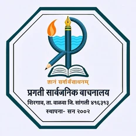
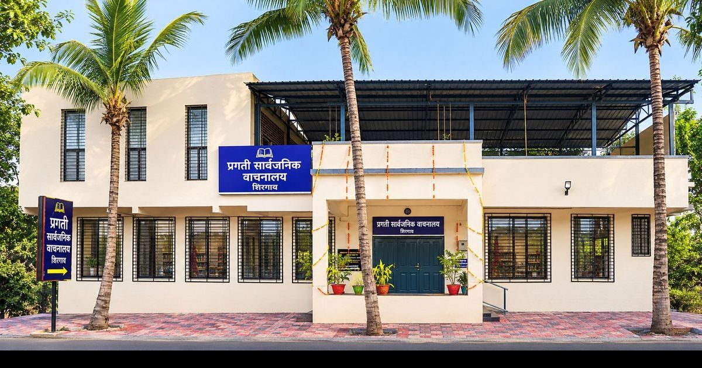

<div align="center">



# 📚 e-Pragati

## Pragati Public Library, Shirgaon

**A welcoming digital home for reading, learning, discovery, and community.**

<p>
  <a href="https://epragati.in/"><strong>🌐 Visit the live website</strong></a>
  ·
  <a href="https://epragati.in/books.html">📚 Browse the catalogue</a>
  ·
  <a href="https://epragati.in/digital.html">💻 Explore the e-Library</a>
</p>

<p>
  
  
  
</p>

</div>

<p align="center">
  
</p>

> **ज्ञानं सर्वार्थ साधनम्**  
> *Knowledge is the means to every good purpose.*

---

## ✨ About the website

**e-Pragati** is the official public-facing website of **Pragati Public Library, Shirgaon**, located in Walwa taluka, Sangli district, Maharashtra.

Started on **14 November 2002**, the library has grown from a small room into a community-focused learning space with a new building, a growing collection, a children’s section, study support, and carefully selected online resources.

This website makes the library easier to discover and use — for children, students, parents, readers, teachers, and citizens — whether they are visiting in person or looking for trusted learning material online.

## 🌟 What visitors can do

| Area | What it offers |
| --- | --- |
| 🧒 **Children’s World** | Stories, poems, picture content, science activities, and joyful learning resources |
| 🎓 **Students** | Career direction, scholarships, entrance examinations, recruitment information, and study guidance |
| 💻 **e-Library** | Curated links for books, education, science, agriculture, culture, careers, civic learning, and more |
| 📚 **Book Catalogue** | Search books by title, author, category, or language |
| 🕘 **Membership & Information** | Library hours, membership details, study-room enquiries, rules, and registration |
| 📷 **Our Journey** | Anniversary memories, inauguration moments, community participation, photographs, and documents |
| 🔍 **Site Search** | Search across the website for pages, sections, topics, and resources |
| ✉️ **Contact & Enquiries** | Send membership requests, feedback, book suggestions, study-room enquiries, and career questions |

## 🧭 Explore the main sections

<table>
  <tr>
    <td align="center" width="25%"><a href="https://epragati.in/"><strong>🏠 Home</strong></a><br><sub>Highlights, daily quiz, updates, statistics, and announcements</sub></td>
    <td align="center" width="25%"><a href="https://epragati.in/children.html"><strong>🧒 Children</strong></a><br><sub>Stories, poems, activities, and child-friendly learning</sub></td>
    <td align="center" width="25%"><a href="https://epragati.in/students.html"><strong>🎓 Students</strong></a><br><sub>Guidance, scholarships, exams, and study material</sub></td>
    <td align="center" width="25%"><a href="https://epragati.in/digital.html"><strong>💻 e-Library</strong></a><br><sub>56 selected digital knowledge sources</sub></td>
  </tr>
  <tr>
    <td align="center"><a href="https://epragati.in/books.html"><strong>📚 Books</strong></a><br><sub>Searchable library catalogue</sub></td>
    <td align="center"><a href="https://epragati.in/info.html"><strong>📋 Information</strong></a><br><sub>Hours, membership, forms, and privacy</sub></td>
    <td align="center"><a href="https://epragati.in/journey.html"><strong>📷 Journey</strong></a><br><sub>Photos, milestones, and acknowledgements</sub></td>
    <td align="center"><a href="https://epragati.in/about.html"><strong>ℹ️ About</strong></a><br><sub>Mission, projects, team, and contact</sub></td>
  </tr>
</table>

## 📊 At a glance

<p align="center">

| | |
| :---: | :---: |
| **2002**<br>Library founded | **8,800**<br>Books in the collection |
| **24 years**<br>Serving the community | **56**<br>Digital knowledge sources |

</p>

## 🎨 Designed for people, not just screens

The website is intentionally built as a simple, friendly public service:

- **Marathi-first experience** with an optional English translation switch
- **Clear pathways** for children, students, readers, and citizens
- **Responsive layout** for phones, tablets, and desktop screens
- **Accessible navigation** with skip links, semantic headings, visible focus states, labelled forms, and keyboard-friendly controls
- **Fast and lightweight** pages with responsive images and no application framework
- **Useful search tools** for both the website and the book catalogue
- **Safe contact flows** that open the visitor’s own email app instead of silently submitting information
- **Trusted-resource approach** with curated links and notices about external websites

## 🛠️ Built with

This is a deliberately lightweight, framework-free static website:

| Technology | Purpose |
| --- | --- |
| **HTML5** | Page structure, semantic content, metadata, and forms |
| **CSS3** | Responsive layouts, colour system, typography, cards, themes, and gallery styling |
| **Vanilla JavaScript** | Search, filtering, CSV catalogue loading, daily quiz, mobile menu, forms, translations, and image viewer |
| **CSV** | Simple, maintainable book catalogue data |
| **WebP / PNG / JPG** | Optimised library photographs, thumbnails, icons, and social preview artwork |
| **GitHub Pages** | Simple static hosting |

There is **no build step, backend, database, or framework**. Every page can be opened and hosted as a static file.

## 📁 Site structure

```text
.
├── index.html          # Home page
├── children.html       # Children’s World
├── students.html       # Student guidance
├── digital.html        # Curated e-Library resources
├── books.html          # Searchable book catalogue
├── info.html           # Hours, membership, forms, and privacy
├── journey.html        # Library history and photo gallery
├── about.html          # Mission, projects, team, and contact
├── search.html         # Website-wide search
├── style.css           # Shared responsive design system
├── site.js             # Shared interactive behaviour
├── data.js             # Editable library information and daily quiz
├── books.csv           # Book catalogue data
├── images/             # Hero images, gallery photos, and thumbnails
├── sitemap.xml         # Search-engine sitemap
└── robots.txt          # Crawler guidance
```
## 🔒 Privacy and safety

The website follows a minimal-data approach:

- The enquiry form asks only for the information needed to respond.
- Submitting the form opens the visitor’s email application; it does not silently send data.
- The site does not ask for Aadhaar numbers, passwords, OTPs, photographs, or bank details.
- Visitors are reminded to use only official scholarship, examination, and government websites.
- External resources are clearly presented as third-party links and may have their own terms.
- Never send donations to a personal phone number, UPI ID, or bank account. Confirm official details directly with the library.

## 📍 Library contact

**Pragati Public Library, Shirgaon**  
Walwa, Sangli, Maharashtra — **416313, India**

- 📞 **Phone:** [+91 97644 84273](tel:+919764484273)
- ✉️ **Email:** [epragatilibrary@gmail.com](mailto:epragatilibrary@gmail.com)
- 🌐 **Website:** [epragati.in](https://epragati.in/)
- 📍 **Map:** [Find the library on Google Maps](https://www.google.com/maps/search/?api=1&query=Pragati+Public+Library+Shirgaon+416313)

## 🙏 A community story

The library’s new home and continuing work are supported by local residents, readers, families, donors, institutions, and well-wishers. The website preserves that journey while making future learning opportunities easier to find.

> **Reading · Reflection · Values · Good company**  
> *That is the path to true progress.*

---

<div align="center">

### 🌱 Read more. Learn more. Grow together.

<a href="https://epragati.in/"><strong>Open e-Pragati →</strong></a>

<br><br>

<sub>Made for the readers and learners of Shirgaon, Maharashtra.</sub>

</div>
